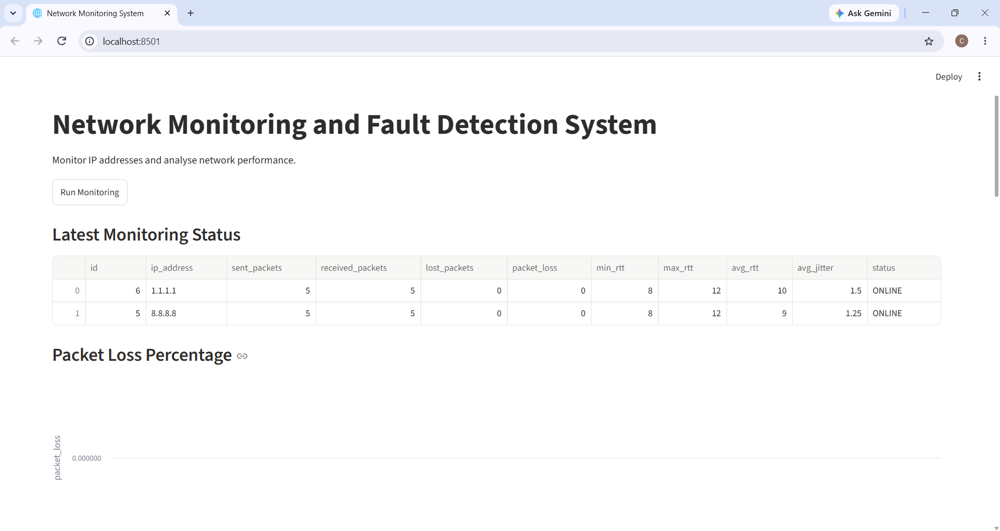

# Network Monitoring and Fault Detection System

A Python-based network monitoring application that checks the availability and performance of multiple IP addresses.

## Features

- Monitor multiple IP addresses.
- Measure packet loss.
- Calculate minimum, maximum and average RTT.
- Calculate average jitter.
- Detect network status: ONLINE, DEGRADED and UNREACHABLE.
- Store monitoring results in an SQLite database.
- Display network statistics through a Streamlit dashboard.
- View historical monitoring records.

## Technologies Used

- Python
- Streamlit
- Pandas
- SQLite
- Subprocess

## Installation

1. Clone this repository.
2. Install the required dependencies:

   pip install -r requirements.txt

3. Run the monitoring engine:

   python multi_ip.py

4. Start the dashboard:

   streamlit run app.py

## Project Structure

- app.py – Streamlit dashboard
- multi_ip.py – Network monitoring engine
- database.py – Database setup
- requirements.txt – Project dependencies
- .gitignore – Files excluded from Git

  ## Dashboard Screenshots

### Main Dashboard

### Monitoring History

### Network Charts

